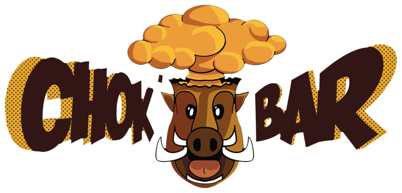
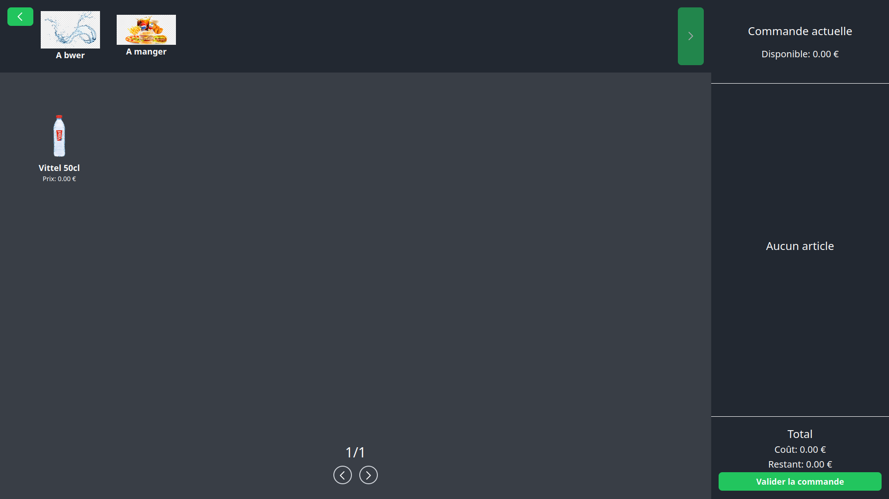

<div align="center">



# Le Bar

Software for running a student bar: self-service kiosk, ordering from your phone, the counter, stock and the cash register.

[](https://github.com/CETEN-OpenBar/bar/releases/latest)
[](https://github.com/CETEN-OpenBar/bar/actions/workflows/ci.yml)
[](LICENSE)
[](https://github.com/CETEN-OpenBar/bar/commits/main)
[](https://github.com/CETEN-OpenBar/bar/graphs/contributors)


</div>

<p align="center">
  
</p>

## What it does

- Members tap their NFC card at the kiosk, type their PIN and order. They can also scan a QR code to log in from their phone.
- From their phone, members can order, check their balance and history, and top up online with HelloAsso.
- Behind the counter, staff see orders arrive live, add money to accounts and close the day.
- Admins manage products, menus, stock, restocks, the shopping list, accounts and the cash register.
- Two small daemons on the bar machine drive the NFC reader, the door and the cash drawer.

## Repository

| Folder | What's inside |
|---|---|
| [`backend/`](backend/) | Go API (Echo + MongoDB) |
| [`frontend/`](frontend/) | SvelteKit app: kiosk, mobile, counter and admin |
| [`nfc/`](nfc/) | NFC card reader daemon |
| [`porte/`](porte/) | Door, cash drawer and fan daemon |
| [`bar.openapi.yml`](bar.openapi.yml) | API spec, the source of both the Go server and the TS client |

## Quick start

You need Docker and [mise](https://mise.jdx.dev/getting-started.html) (or Nix, see the [development guide](docs/DEVELOPMENT.md#prerequisites)).

```sh
mise install    # Go, Node and Task at the right versions
task setup      # config files and dependencies
task dev        # MongoDB, API on :8080 (reloads on save), app on :5173
task seed       # sample products and test accounts
```

Open <http://localhost:5173/borne>, type `1`, press <kbd>Enter</kbd>, then enter the PIN `1234`. That logs you in as the default admin without a card reader.

## Documentation

- [Development guide](docs/DEVELOPMENT.md): setup, configuration, regenerating the API, checks, releases
- [Architecture](docs/ARCHITECTURE.md): how the pieces fit together and where things live

## Contributing

Open an issue or a pull request. There are [issue templates](https://github.com/CETEN-OpenBar/bar/issues/new/choose) and a PR template.

<a href="https://github.com/CETEN-OpenBar/bar/graphs/contributors">
  
</a>

## License

[MIT](LICENSE)
